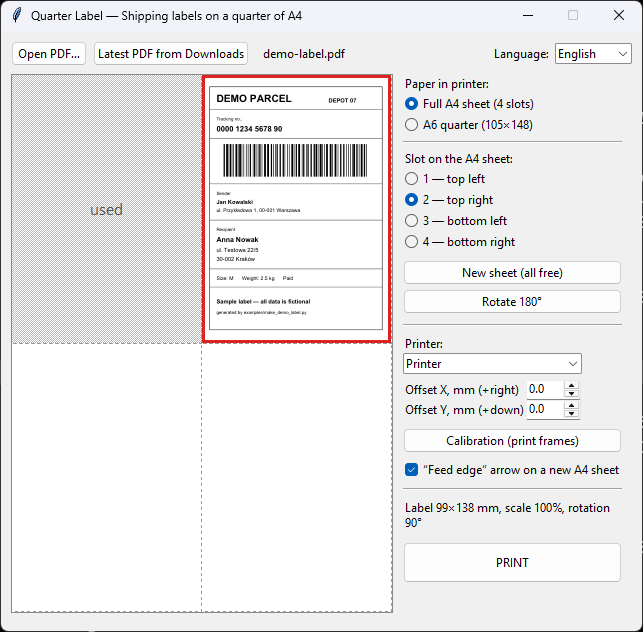
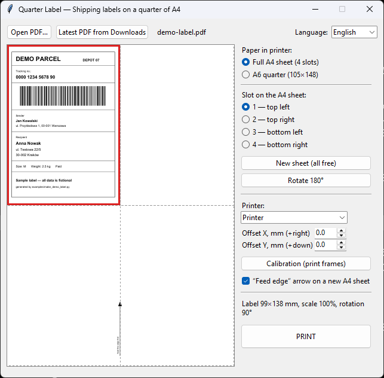
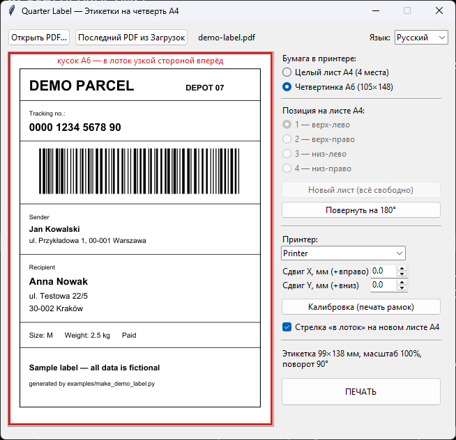

# Quarter Label

**Print shipping labels on a quarter of an A4 sheet — one label a day, no wasted paper.**

Courier services (Orlen Paczka, DPD, InPost, DHL, GLS, Vinted shipping…) usually give you a PDF with a single A6 label on a whole A4 page. If you only send one parcel a day, every label wastes ¾ of a sheet. Quarter Label takes that PDF, finds the label, crops it, rotates it upright and prints it **exactly** where you want it:

- **A6 mode**: cut an A4 sheet into 4 pieces (105 × 148 mm) and print each label centred on one piece.
- **A4 mode**: keep the whole sheet (plain paper or a 4 × A6 label sheet), print into slot 1, 2, 3 or 4, and the app remembers which slots are already used.

[Русская версия ниже](#русский)

| A4 sheet: slot 2, slot 1 already used | New sheet: label + "feed this edge first" arrow | A6 piece, Russian UI |
|---|---|---|
|  |  |  |

## Features

- Auto-detects the label area on the page (no manual cropping)
- Auto-rotates by text direction, plus a one-click 180° flip
- Prints 1:1 through Windows GDI. No "fit to page" scaling, no PDF viewer involved.
- Live preview of the sheet with used and free slots
- Remembers used slots on the A4 sheet. A one-time "feed this edge first" arrow on a new sheet shows how to put it back in the tray.
- Calibration print plus X/Y offset in mm for your printer
- "Latest PDF from Downloads" button, and drag-and-drop a PDF onto the shortcut
- Multi-page PDFs: each page goes into the next slot
- English and Russian UI

## Try it without a real label

`examples/demo-label.pdf` is a fictional label laid out like many courier PDFs: A4 landscape, label rotated in the corner. Regenerate it with `python examples/make_demo_label.py`.

## Requirements

- Windows 10/11
- Python 3.10+
- Any printer with a Windows driver (A6 mode needs a driver that supports A6 paper)

## Install

```bat
git clone https://github.com/DIGIALLL/quarter-label.git
cd quarter-label
pip install -r requirements.txt
```

## Run

```bat
pythonw label_print.py            :: open the window
pythonw label_print.py label.pdf  :: open with a label
run.bat label.pdf                 :: same, drag a PDF onto run.bat
```

Tip: create a desktop shortcut to `pythonw.exe "path\to\label_print.py"`. Dropping a PDF onto the shortcut opens it straight away.

## First-time setup

1. Choose your printer.
2. Press **Calibration** with plain paper in the tray. It prints frames 5 mm inside each label slot.
3. Hold the print against your label sheet (or the cut piece) in front of a light and enter the X/Y offset in mm if needed.

## Daily use

1. Download the label PDF, then press **Latest PDF from Downloads**.
2. Check the preview and pick the slot (A4 mode) or load an A6 piece (A6 mode).
3. Press **PRINT**.

When you reuse a sheet in A4 mode, load it exactly as the first time: same side, same edge first. The small arrow printed on a new sheet marks that edge.

Settings live in `config.json` and the sheet state in `state.json`, next to the script. A copy of every printed page goes to `output/`. All three are git-ignored because they contain personal data.

---

## Русский

**Печать почтовых этикеток на четверть листа A4: одна наклейка в день без лишнего расхода бумаги.**

Службы доставки (Orlen Paczka, DPD, InPost, DHL, Vinted…) отдают PDF, где одна этикетка A6 лежит на целом листе A4. Программа сама находит этикетку, обрезает её, поворачивает текстом вверх и печатает точно в нужное место:

- **Режим A6**: лист A4 заранее режется на 4 части (105 × 148 мм), каждая этикетка печатается по центру куска.
- **Режим A4**: целый лист (обычный или с 4 наклейками A6), печать в позицию 1–4. Занятые места программа запоминает.

Возможности: автоопределение и автоповорот этикетки, предпросмотр, печать 1:1 без масштабирования, калибровка со сдвигом X/Y в мм, кнопка «Последний PDF из Загрузок», перетаскивание PDF на ярлык. Стрелка «этот край первым в лоток» печатается один раз на новом листе. Интерфейс на русском и английском.

Установка: `pip install -r requirements.txt`, запуск: `pythonw label_print.py`.

## License

MIT
